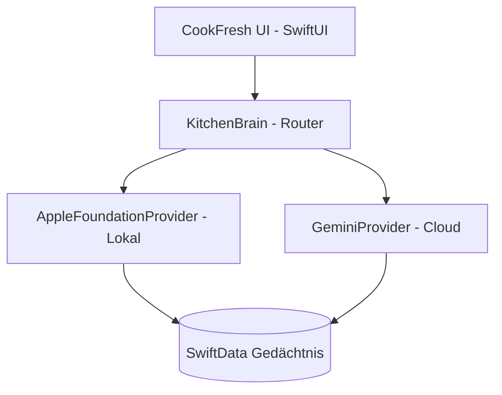

# 🧠 CookFresh AI-Gedächtnis & Hybrid-Intelligenz (Gesamtdokumentation)

Dieses Dokument beschreibt die vollständige Architektur, Implementierung und UI-Integration für ein persistentes, mitdenkendes KI-Gedächtnis in CookFresh unter Verwendung von SwiftData, dem lokalen Apple Foundation Models Framework (On-Device) und der Google Gemini API (Cloud).

## 1. Vision: Ein Küchenassistent, der nichts vergisst

Herkömmliche Rezept-Apps sind passive Datenbanken. CookFresh soll sich wie ein erfahrener Mitkoch verhalten, der über Wochen und Monate hinweg dazulernen kann:

- Explizite Regeln merken: „Ich mag keinen Koriander“, „Keine Rosinen im Nachtisch“, „Laktoseintoleranz bei Gästen beachten“.
- Implizite Muster erkennen: „Pasta gab es erst vorgestern“, „Unter der Woche maximal 30 Minuten Kochzeit“, „Nach einem schweren Braten lieber ein leichtes, fruchtiges Dessert“.
- Rezept-Historie & Anpassungen: „Dieses Curry wurde bereits 4× gekocht und als Favorit markiert“, „Beim Tiramisu wird der Zucker immer um 20 % reduziert“.

## 2. Hybride KI-Architektur (Apple Foundation Models + Gemini API)

Beide KI-Systeme greifen auf dasselbe gemeinsame SwiftData-Gedächtnis zu, übernehmen aber unterschiedliche Aufgaben:

| Aufgabe | Primäre Engine | Begründung |
|---|---|---|
| Schnelle Alltagsfragen („Was koche ich heute?“) | Apple Foundation Models (Lokal) | 0 ms Netzwerklatenz, funktioniert offline, 100 % privat. |
| Gedächtnis-Extraktion im Hintergrund | Apple Foundation Models (Lokal) | Erkennt neue Vorlieben aus Chats sofort und kostenlos lokal. |
| Wochenplanung & komplexe Menüs | Gemini API (gemini-2.5-flash / pro) | Riesiges Kontextfenster für 200+ Rezepte gleichzeitig. |
| Multimodale Aufgaben (Kühlschrank-Foto) | Gemini API | Überlegene Bilderkennung und OCR. |
| Fallback | Gemini API | Garantiert volle Funktionalität. |

### Architektur-Diagramm



## 3. Das 3-stufige SwiftData-Gedächtnismodell

### 3.1 MemoryEntry (Fakten, Vorlieben & Abneigungen)

```swift
import Foundation
import SwiftData

enum MemoryCategory: String, Codable, CaseIterable, Identifiable {
    case allergyOrTaboo = "Allergie / Tabu"
    case ingredientPref = "Zutaten-Vorliebe"
    case dessertRule    = "Nachtisch-Regel"
    case cookingHabit   = "Kochgewohnheit"
    case recipeNote     = "Rezept-Anpassung"

    var id: String { rawValue }

    var systemImage: String {
        switch self {
        case .allergyOrTaboo: return "exclamationmark.triangle.fill"
        case .ingredientPref: return "heart.fill"
        case .dessertRule:    return "birthday.cake.fill"
        case .cookingHabit:   return "clock.fill"
        case .recipeNote:     return "note.text"
        }
    }
}

@Model
final class MemoryEntry {
    @Attribute(.unique) var id: UUID
    var fact: String
    var category: MemoryCategory
    var importance: Int
    var createdAt: Date
    var lastUsedAt: Date
    var relatedRecipeID: UUID?

    init(fact: String, category: MemoryCategory, importance: Int = 3, relatedRecipeID: UUID? = nil) {
        self.id = UUID()
        self.fact = fact
        self.category = category
        self.importance = importance
        self.createdAt = .now
        self.lastUsedAt = .now
        self.relatedRecipeID = relatedRecipeID
    }
}
```

### 3.2 Implizite Signale am Recipe-Modell

Zusätzlich zu den KI-Notizen liefert das bestehende Rezeptmodell wertvolle Fakten (z.B. `cookCount`, `isFavorite`, `prepTimeMinutes`).

## 4. Kontext-Komprimierung (MemoryContextBuilder)

Bevor eine Anfrage gesendet wird, verdichtet ein Builder die wichtigsten Informationen aus SwiftData zu einem kompakten System-Prompt.

```swift
struct MemoryContextBuilder {
    static func buildContext(memories: [MemoryEntry], recentRecipes: [Recipe], favoriteDesserts: [Recipe]) -> String {
        var lines: [String] = []
        // Implementierung: Sortierung nach Wichtigkeit & Relevanz
        return lines.joined(separator: "\n")
    }
}
```

## 5. Implementierung der KI-Provider

### 5.1 Gemeinsames Interface

Alle Provider implementieren das `KitchenAIProvider` Protokoll (für `suggestMenu` und `extractMemories`), wodurch das System zwischen lokalem Modell und Gemini API transparent wechseln kann.

### 5.2 Lokaler Provider (Apple Foundation Models)

Nutzt `@Generable` für garantierte Swift-Typen und direktes Tool-Calling auf SwiftData.

### 5.3 Cloud Provider (Google Gemini API)

Nutzt JSON-Schema-Erzwingung (`responseSchema`), um exakt die benötigte `MenuSuggestion`-Struktur zu erhalten.

## 6. Der zentrale KitchenBrain-Orchestrator

`KitchenBrain` (ein `@Observable` Singleton) ist die Logik-Zentrale:

- Lädt Kontext aus SwiftData.
- Wählt Engine basierend auf Verfügbarkeit.
- Führt Hintergrund-Tasks zum "Lernen" aus (`learnFromUserInput`).

## 7. UI-Integration

- **MemoryManagementView**: Zentrale Ansicht für den Nutzer, um Fakten einzusehen oder manuell zu löschen.
- **MemoryLearnedToast**: Ein Overlay, das informiert, wenn die KI im Hintergrund eine neue Vorliebe gelernt hat (mit Undo-Funktion).

## 8. Praxis-Beispiel (Szenario)

User: "Keine schweren Nachtische nach Pasta."
System: Speichert `MemoryEntry(fact: "Nach Pasta leichtes Dessert", category: .dessertRule)`.
Feedback: User sieht "🧠 Gemerkt: Nachtisch-Regel für Pasta" als Toast.

## 9. Leitlinien für AI-Coding-Agents (Update für AGENTS.md)

- Hybrid AI Routing: Immer über `KitchenBrain`.
- Local-First Principle: Standardmäßig `AppleFoundationProvider`.
- Shared SwiftData Memory: Persistenz via `MemoryEntry`.
- Strict Concurrency: `Sendable`-Konformität für alle DTOs.
- Transparency: `appliedMemories` immer in der UI anzeigen.
